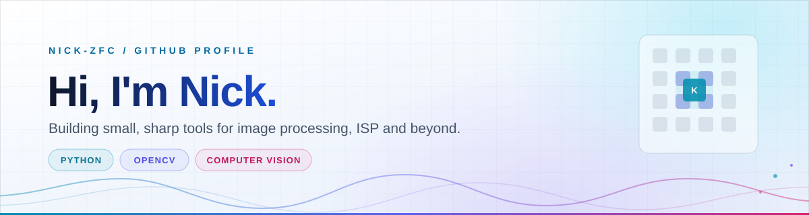
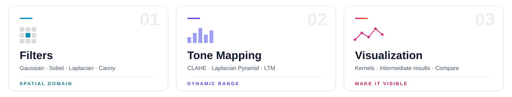
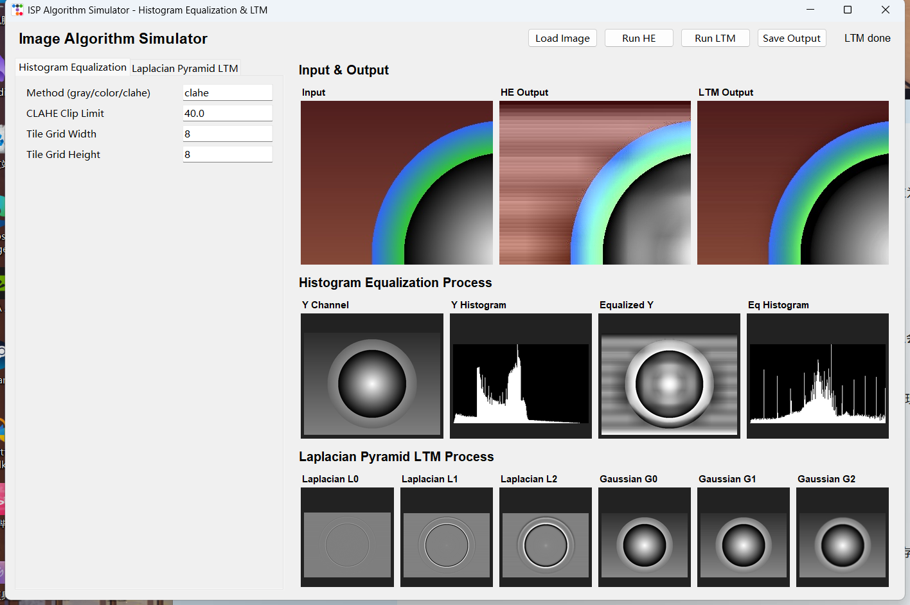

<picture>
  <source media="(prefers-color-scheme: dark)" srcset="assets/banner-dark.svg">
  
</picture>

**把算法的过程摊开给人看，而不只是给个结果。**

---

## 👋 关于我

我是 Nick，在 GitHub 上折腾 **图像处理 / ISP（图像信号处理）** 方向的小工具。

在意的不是「调一个函数拿到输出」，而是中间那几步：卷积核怎么滑过像素、边缘响应怎么被算出来、动态范围怎么被压回去。所以做出来的东西，通常都带一个能改参数、能看核、能和原图并排对照的界面。

工具链偏轻量：**Python + OpenCV / NumPy**，交互界面用 **Tkinter**。

## 🔭 在做

- 维护 **[ispalgo](https://github.com/nick-zfc/ispalgo)** —— 交互式滤波与色调映射 playground
- 把更多只存在于公式里的 ISP 步骤，做成能拖参数、看得见中间结果的东西

## 🛠️ 技术栈

  

Python · OpenCV · NumPy · Pillow · Tkinter / ttkbootstrap · Git

## 🎯 关注方向

<picture>
  <source media="(prefers-color-scheme: dark)" srcset="assets/focus-dark.svg">
  
</picture>

## 🧩 精选项目

### 🔬 [ispalgo](https://github.com/nick-zfc/ispalgo)

> Interactive ISP algorithm playground —— 把经典图像算法从公式一路摊开到像素。

| | |
| :--- | :--- |
| **实现** | Gaussian / Sobel / Laplacian / Canny 滤波、CLAHE 直方图均衡、拉普拉斯金字塔色调映射 |
| **特色** | 卷积核按 OpenCV 实际应用方式渲染；参数可调、中间结果并排对照 |
| **技术** | Python · OpenCV · NumPy · Pillow · ttkbootstrap |
| **质量** | `tests/test_kernels.py` 覆盖核计算；兼容 OpenCV 4.x / 5.x 稳定 API |

  <picture>
    <source media="(prefers-color-scheme: dark)" srcset="assets/preview-dark.png">
    
  </picture>

截图会随 GitHub 主题切换：滤波算子 / 直方图均衡与色调映射

## 📮 联系

关于图像处理、ISP 或 OpenCV 的话题，欢迎到 [ispalgo](https://github.com/nick-zfc/ispalgo/issues) 开 issue 聊。

---

  Thanks for stopping by · 横幅与卡片为自绘，深浅主题自动适配

